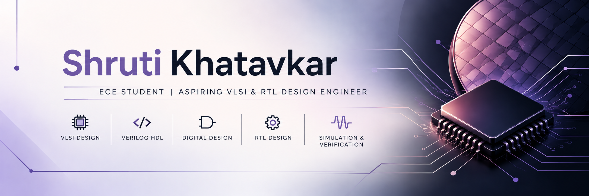

  

  # Hi, I'm Shruti Khatavkar 

### ECE Student | Aspiring VLSI & RTL Design Engineer

I'm passionate about digital hardware design, Verilog HDL, and semiconductor technology. I'm building practical skills through hands-on RTL projects, testbench development, and simulation.

## 🔧 Technical Skills

  
  
  
  
  

- HDL: Verilog
- Digital Design: Logic gates, adders, multiplexers, flip-flops, counters, FSMs
- Verification: Testbench development and simulation
- Tools: EDA Playground, Icarus Verilog, GitHub

## 🚀 Featured Projects

Verilog HDL & VLSI Portfolio

Digital logic designs, sequential circuits, testbenches, simulation results, and an FSM-based 1011 sequence detector.

[View my VLSI portfolio](https://github.com/kshruti17/Shruti-khatavkar_VLSI_portfolio)

RFID-Based Healthcare System

An RFID-based patient identification and monitoring project using embedded systems.

[View my RFID project](https://github.com/kshruti17/RFID-Healthcare-System)

Hardware Accelerator for Digital Evidence Protection

My major academic project explores hardware-based evidence protection using AES-128 encryption and SHA-256 hashing. My contribution focuses on FSM, memory, and module integration.

## 🏆 Achievements

- 🥇 First Prize at IEEE NOVUS for Drone Technology in Agriculture.
- IEEE Execom member and Secretary of the Computational Intelligence Society.
- Contributed to organizing the EXTREME coding event.

## 🎯 Current Goals

## 📚 Currently Learning

- **Verilog HDL:** Writing synthesizable RTL and reusable modules
- **FSM Design:** State transitions and sequence detectors
- **Functional Verification:** Testbench development and simulation
- **Digital Design:** Strengthening combinational and sequential logic

## 🎯 Career Goal

Building a strong foundation for opportunities in **VLSI Design, RTL Design, and Functional Verification**.

I learn by implementing designs, testing different input conditions, debugging issues, and documenting simulation results.

- Strengthen my Verilog and RTL design skills.
- Build practical digital design and verification projects.
- Learn semiconductor design and industry workflows.

## 🤝 Connect With Me

- [LinkedIn](https://www.linkedin.com/in/shruti-khatavkar)
- [GitHub](https://github.com/kshruti17)
- Email: khatavkarshruti17@gmail.com

*Learning, building, and growing in VLSI and digital hardware.* ⚡
